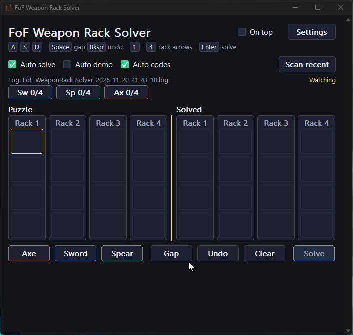

# FoF Weapon Rack Solver

**Version 1.1**

Helper for the **Favor of Fortune – Eriak Zek** raid in EverQuest. During the weapon-rack mechanic, you need to sort axes, swords, and spears across four racks. This app takes the current rack layout (typed in by hand or read from the EQ log), finds a short sequence of moves to finish the puzzle, and can show demos, codes, and optional Discord posts.

## Download

[Latest build](https://github.com/Neclub/FoF-WeaponRack-Solver/releases/latest) — download `FoF_WeaponRack_Solver.exe` from the [latest release](https://github.com/Neclub/FoF-WeaponRack-Solver/releases/latest).

## Manual

[Weapon Rack Solver User Manual](docs/Weapon-Rack-Solver-User-Manual.docx)
